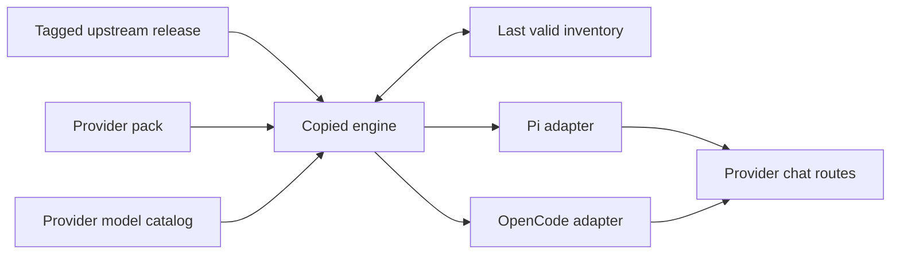

# Provider integration design

A provider checkout owns the model catalog configuration for one endpoint and pins the engine it runs. Copy-in makes the shared source visible in each update diff and keeps the provider's files outside the replacement directory. [Update procedure](SYNC.md)

The engine decides the available inventory. Pi and OpenCode use that inventory to send requests through their native SDKs.

## Inventory

A valid live response replaces the inventory, including a valid empty list. On a discovery failure, the runtime keeps the last valid snapshot for the provider connection. A pack can supply a small fallback for the first startup. Explicit live checks fail on discovery errors.

A pack declares fields or decodes provider-specific records. Context and output limits track their sources independently. Chat capabilities come from the catalog or pack, with conservative defaults when evidence is missing. [Thinking policy](THINKING.md)

For a provider with multiple protocols, normalized models carry the selected native API. Models with unsupported routes stay outside both pickers. A provider can define its own catalog reader to combine multiple catalog views before normalization.

## Acceptance

- A fresh generated checkout can install from its lockfile, discover a fixture, and send a streamed chat from both native hosts.
- A catalog change removes retired models. An empty live result and a failed discovery produce different observable outcomes.
- A compatible engine update and rollback preserve provider files. A failing update restores the previous engine and pin.
- Guts AI, CommandCode, and 9Router exercise the provider contracts. Any live chat verification uses a model with confirmed zero input and output rates. The fixture path covers the same contracts when a provider offers no usable free model.
